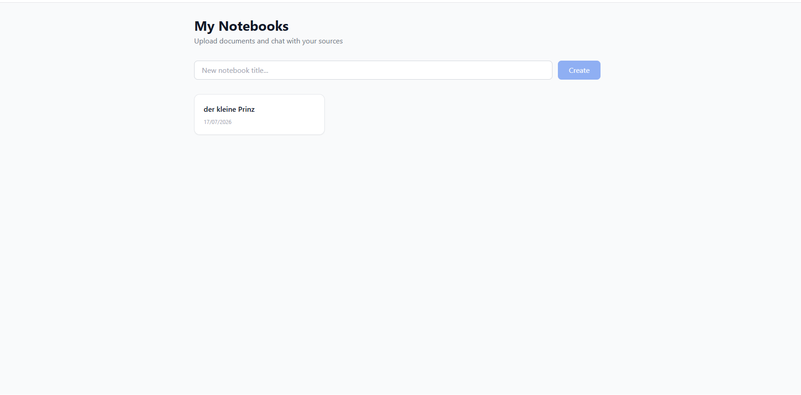
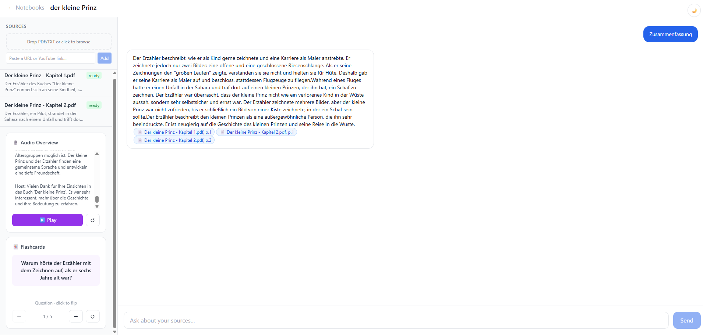

# NotebookLM Clone

Ein KI-gestützter Forschungsassistent. Dokumente hochladen (PDF, Text, URL, YouTube), per Chat Fragen stellen — Antworten mit klickbaren Quellenangaben die direkt auf die richtige Seite springen.

## Live Demo

- **Frontend:** https://notebook-lm-clone-918h.vercel.app/
- **Backend API:** https://notebooklmclone-lsb7.onrender.com

> ⚠️ Das Backend läuft auf Render Free Tier. Nach 15 Minuten Inaktivität braucht der Server beim ersten Aufruf ca. 30–60 Sekunden zum Aufwachen. Danach reagiert alles sofort.

> ⚠️ **YouTube Import funktioniert in der Live-Demo nicht.** YouTube blockiert Transkript-Anfragen von Cloud-Server-IPs (Render, AWS, GCP, ...) grundsätzlich — unabhängig vom jeweiligen Video. Das Feature läuft nur bei lokalem Setup (siehe unten), wo die Anfrage von einer normalen Heim-IP kommt.

## Screenshots

| Notebooks | Chat mit Zitierungen, Audio Overview & Flashcards |
|---|---|
|  |  |

## Features

- **RAG-Chat mit Zitierungen** — Fragen werden mit [Quelle: Datei, Seite X] beantwortet
- **PDF-Viewer** — Klick auf Zitat springt direkt zur richtigen Seite
- **Auto-Summary** — Jede Quelle wird beim Upload automatisch zusammengefasst
- **Audio Overview** — LLM generiert ein 2-Sprecher Podcast-Skript, Web Speech API liest es vor
- **Flashcards** — Automatisch generierte Lernkarten aus dem Notebook-Inhalt
- **YouTube Import** — YouTube-URLs direkt importieren (Transkript wird automatisch geholt)
- **URL-Import** — Webseiten als Quelle hinzufügen

## Tech Stack

| Schicht | Technologie |
|---|---|
| Frontend | React + Vite + TypeScript + Tailwind |
| Backend | Python 3.11 + FastAPI |
| Datenbank | SQLite via SQLModel |
| Vektoren | numpy (Cosine Similarity) |
| LLM | Groq API (`llama-3.3-70b-versatile`) |
| Embeddings | sentence-transformers (`all-MiniLM-L6-v2`) |
| Streaming | Server-Sent Events (SSE) |

## Lokales Setup

### Voraussetzungen
- Python 3.11+
- Node.js 18+
- [Groq API Key](https://console.groq.com) (kostenlos, kein Credit Card nötig)

### Backend

```bash
cd backend
python -m venv venv
source venv/bin/activate  # Windows: venv\Scripts\activate
pip install -r requirements.txt
cp .env.example .env      # GROQ_API_KEY eintragen
uvicorn main:app --reload --port 8000
```

### Frontend

```bash
cd frontend
npm install
cp .env.example .env      # VITE_API_URL=http://localhost:8000
npm run dev
```

Oder mit Docker Compose:

```bash
docker-compose up
# Backend:  http://localhost:8000
# Frontend: http://localhost:5173
```
